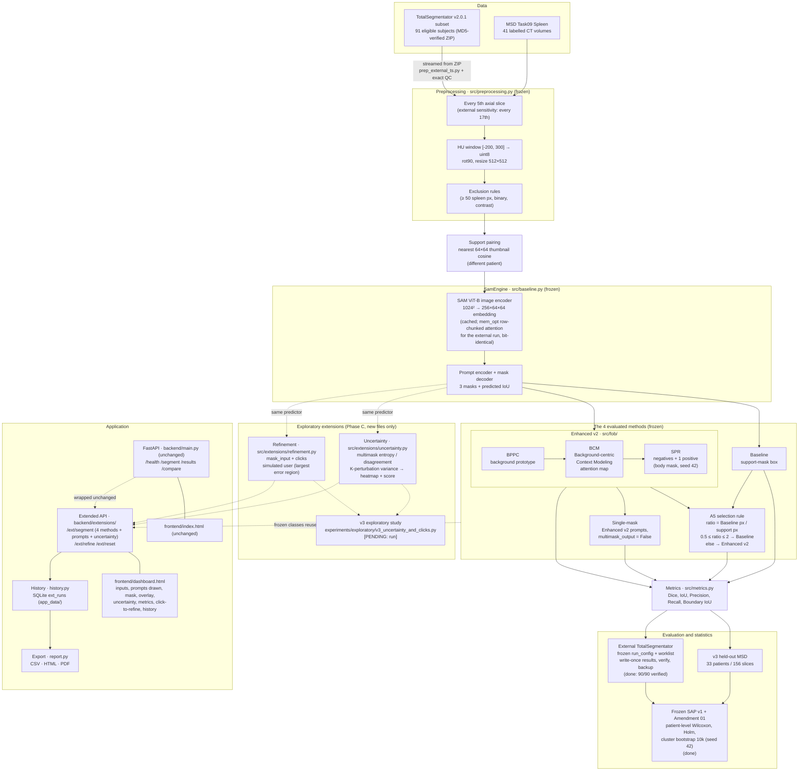

# Architecture Diagram

The whole system, from raw CT to the dashboard and its exports.

* **Solid arrows:** the frozen research pipeline, used for every reported result.
* **Dashed arrows:** the exploratory Phase C extensions. They are new files only, and none of them feeds
  back into the frozen evaluation.

The diagram renders on GitHub, in VS Code (with a Mermaid extension) and at mermaid.live.

## Reading guide

| Layer | Frozen? | Where documented |
|---|---|---|
| Preprocessing, SamEngine, the 4 methods, metrics | Yes. Code hashes are in `results/external_ts/eval/run_config.json` | [METHODOLOGY](METHODOLOGY.md), [SYSTEM_ARCHITECTURE](SYSTEM_ARCHITECTURE.md) |
| External pipeline (manifest, QC, runner, mem_opt, guard, verify, backup) | Yes (runner and config) | [SYSTEM_ARCHITECTURE §3](SYSTEM_ARCHITECTURE.md) |
| Statistics | Yes: SAP v1 plus Amendment 01 | `results/external_ts/analysis_plan/`, [SAP_AMENDMENT_01](SAP_AMENDMENT_01_2026-11-23.md) |
| Uncertainty, refinement, extended API, dashboard, history and export | No. Exploratory, new files | [EXPLORATORY_FEATURES](EXPLORATORY_FEATURES.md), [API_DOCUMENTATION](API_DOCUMENTATION.md) |
